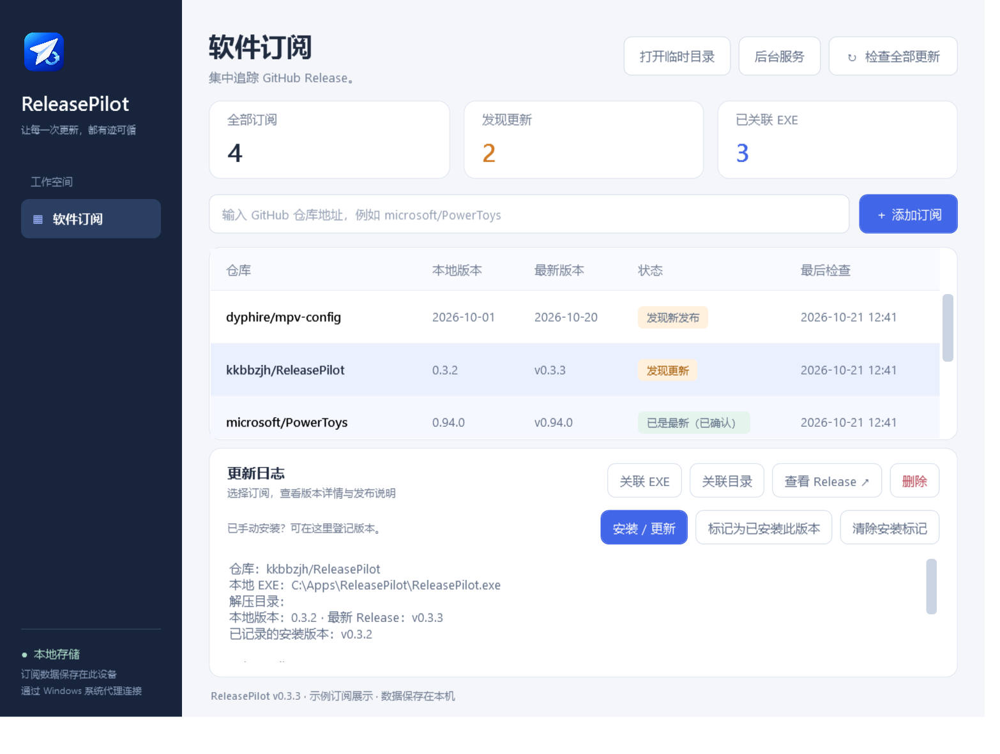
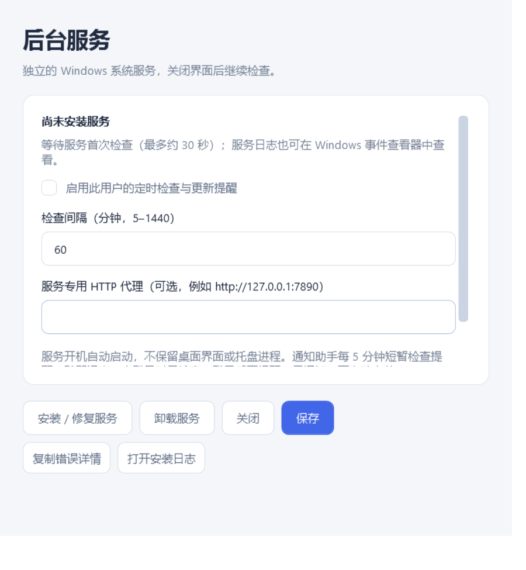

<p align="center"></p>
<h1 align="center">ReleasePilot</h1>
<p align="center">把 GitHub 上的软件，管到你的电脑里。</p>
<p align="center"><a href="https://github.com/kkbbzjh/ReleasePilot/releases/latest">下载最新版</a> · <a href="#界面预览">界面预览</a> · <a href="#快速开始">快速开始</a> · <a href="#后台检查与通知">后台服务</a></p>

ReleasePilot 是一款 Windows 桌面 GitHub 软件更新管理器。添加仓库、关联本地软件，就能集中检查 Release，并按安装包、压缩包或单文件的方式更新。也适用于 MPV 整合包、配置包等需要解压到本地目录的项目。

**当前版本：v0.3.3 · Windows x64 · 单文件 EXE · 无需另装 .NET**

## 界面预览



> 真实 Windows 软件界面，使用示例订阅展示。截图中的版本、路径和更新状态仅作演示，不代表这些项目当前的最新版本。

<details>
<summary>查看后台服务设置</summary>



</details>

## 可以做什么

| 功能 | 说明 |
| --- | --- |
| 集中检查更新 | 订阅 GitHub 仓库，查看本地版本、最新 Release 和发布说明 |
| 安装包更新 | 下载 EXE / MSI，打开原软件的安装向导 |
| 压缩包更新 | 解压 ZIP / 7z 到关联目录，可保留自定义配置、去掉唯一顶层目录 |
| 单文件更新 | 替换本地 EXE，也支持 ReleasePilot 自更新 |
| 修复损坏文件 | 同一版本也能重新下载、安装、解压或替换 |
| 附件筛选 | 按文件名识别系统与架构，优先推荐适合当前 Windows 设备的附件 |
| 解压进度 | 显示当前文件、文件数量、已解压大小、进度与耗时，支持取消解压 |
| 后台提醒 | 可选独立 Windows 系统服务，关闭桌面界面后继续检查 |

## 快速开始

1. 在 [Releases](https://github.com/kkbbzjh/ReleasePilot/releases/latest) 下载 `ReleasePilot-v版本号.exe`，双击运行。`SHA256SUMS.txt` 可用于核验下载文件。
2. 输入 `owner/repo` 或 GitHub 仓库地址，点击“添加订阅”。
3. 根据本地软件的形式，点击“关联 EXE”或“关联目录”。
4. 点击“检查全部更新”，再选择订阅，点击“安装 / 更新”。
5. 核对附件、更新方式和目标位置，确认后执行。需要后台提醒时，再安装可选的后台服务。

### 选择哪种更新方式？

| 下载的附件 | 更新方式 | 本地如何关联 |
| --- | --- | --- |
| 需要安装的 `.exe` / `.msi` | 启动安装向导 | 安装完成后选择软件主程序并确认结果 |
| `.zip` / `.7z` 软件或配置包 | 解压并合并到目录 | “关联目录”选择已经解压好的目标目录 |
| 可直接运行的单个 `.exe` | 替换单文件 | “关联 EXE”选择本地要替换的主程序 |

EXE 既可能是安装器，也可能是便携单文件，请根据原项目的说明选择更新方式。安装器退出后，只有确认安装成功并选择主程序，才会记录已安装版本。

**更新不创建备份，同名文件会直接覆盖。** 压缩包中没有包含的本地文件会保留；不希望被覆盖的配置，请先加入“保留路径”。文件夹更新中途失败时可能已更新部分文件，可关闭目标软件后重试。

### 例如：更新 MPV 整合包或配置包

以 [dyphire/mpv-config](https://github.com/dyphire/mpv-config) 为例：

1. 添加仓库，点击“关联目录”，选择本地整合包或配置包的解压目录。
2. 点击“安装 / 更新”，手动选择所需的 ZIP / 7z 附件，使用解压更新方式。
3. 按包内结构决定是否“去掉顶层目录”。只有整个包恰好包含一个顶层目录时，才能使用此选项。
4. 将不想覆盖的自定义配置填入“保留路径”，例如 `mpv.conf;input.conf;portable_config`，多个相对路径用分号分隔。
5. 确认后，软件先下载、解压到临时目录，再合并到目标目录。

配置包按成功更新或手动登记的 Release 追踪版本，不会拿播放器 EXE 的版本号当作配置包版本，也不会逐个监控配置文件变化。

## 后台检查与通知

后台服务是可选功能。点击 **“后台服务 → 安装 / 修复服务”**，完成 Windows 管理员授权后启用；如果程序已经提升权限，可能不会再次弹窗。

- 真正的 Windows 系统服务 `ReleasePilotMonitor`，开机自动启动，使用低权限 `LocalService` 账户。
- **关闭主窗口后，桌面程序完全退出，不留托盘进程。** 服务独立运行，采用 Native AOT 编译，不加载 WPF 界面或 .NET 运行时。
- 检查间隔可设为 5–1440 分钟。服务不会继承登录用户的代理设置，必要时可单独填写 HTTP / HTTPS 代理。
- 提醒由当前用户的计划任务交付：登录时及每 5 分钟短暂运行通知助手，没有待提醒更新时立即退出；有更新时提交 Windows 通知后退出。
- 未登录时继续检查，登录后交付提醒。同一版本只提醒一次，点击通知打开软件后自行决定是否更新。系统勿扰模式或关闭应用通知可能影响显示。
- 只检查和提醒，**不会自动安装软件**。服务不读取或修改关联的软件目录。

“保存”可启用或暂停当前用户的检查；“卸载服务”需要管理员权限，会停止这台电脑所有用户的 ReleasePilot 服务检查，保留订阅和本地软件。服务安装程序已包含在下载的单文件 EXE 内，无需另找安装包。

## 常见问题

### “需要确认”和“标记为已安装此版本”是什么意思？

有些软件的 EXE 文件版本与 GitHub 标签不同，日期、自定义标签也不一定能安全比较。只有你已经手动安装好对应 Release 时，才使用“标记为已安装此版本”登记关系；它不会下载、安装或修复软件。

尚未更新或软件损坏时，请使用“安装 / 更新”。勾选“重新安装此版本（修复损坏文件）”后，即使版本相同也会重新下载。“清除安装标记”只清除版本关系，不会卸载软件。

### 一个 Release 有多个系统和架构的附件，怎么选？

软件根据附件文件名识别 Windows、Linux、macOS 和 x64、x86、ARM64 等，优先推荐当前设备适用的附件。没有标记或标记冲突时需要手动选择，其他系统的包不能直接应用；不匹配的架构需额外确认兼容性。

识别结果是辅助提示，请同时核对发布说明。驱动、插件还需核对宿主架构；无平台标记的配置包可手动选择。

### 解压看起来不动了？

读取目录、准备解压器或处理 7z 固实压缩包时，可能较久停在同一个文件。窗口会持续显示耗时，获得解压数据后更新文件名、大小和进度；长时间无新数据时会提示等待或取消，不会仅因耗时较长就判定失败。

取消解压需要等待当前读取结束，解压阶段尚未覆盖目标目录。

### 服务安装失败？

v0.3.3 修复了继承 PowerShell 7 模块路径导致 Windows PowerShell 安装命令加载失败的问题。安装或修复失败时，窗口会显示失败步骤、Windows 错误码和日志位置，可直接点击“复制错误详情”或“打开安装日志”。无需先改账户或关闭 UAC。

## 数据与临时文件

| 内容 | 默认位置或入口 |
| --- | --- |
| 订阅数据库与设置 | `%LOCALAPPDATA%/ReleasePilot/` |
| 临时下载、历史更新文件 | 主界面的“打开临时目录” |
| 服务安装日志 | 服务设置中的“打开安装日志”，或 `%LOCALAPPDATA%/ReleasePilot/Logs/` |
| 服务程序 | `%ProgramFiles%/ReleasePilot Service/` |
| 按用户隔离的服务配置与状态 | `%ProgramData%/ReleasePilot/Monitor/<用户 SID>/` |

ZIP / 7z 和单文件更新结束后会清理临时文件；安装器可能还在运行子进程，因此其临时文件保留，可自行清理。旧版本留下的备份不会自动删除，新更新不再创建备份。附件提供 GitHub SHA256 摘要时会核验，文件大小或摘要不符时停止更新。

## 开发与构建

需要 Windows 和 .NET 10 SDK。桌面调试：

```powershell
dotnet restore
dotnet run --project ReleasePilot.csproj
```

生成内置的 Native AOT 服务还需要 Visual Studio 的 C++ 桌面构建工具。先发布服务，再构建桌面程序：

```powershell
dotnet publish Monitor/ReleasePilot.Monitor.csproj -c Release -r win-x64 -o service-payload
dotnet publish ReleasePilot.csproj -c Release -r win-x64 --self-contained true -p:PublishSingleFile=true -p:IncludeNativeLibrariesForSelfExtract=true -p:EnableCompressionInSingleFile=true -o publish
```

逻辑检查：`dotnet run --project tests/VersionHelper.Tests/VersionHelper.Tests.csproj -c Release`。Windows 界面检查：`dotnet run --project tests/UiSmoke.Tests/UiSmoke.Tests.csproj -c Release`，需先生成服务载荷。追加 `-- --screenshots-only` 可用示例订阅生成实际界面截图，不连接 GitHub、不执行安装或更新。

推送 `main`、`v*` 标签或手动运行 `.github/workflows/release.yml`，会执行测试、构建并上传带版本号的 EXE 和 `SHA256SUMS.txt`；符合发布条件且版本尚未发布时创建 Release。版本标签应与项目的 `Version` 保持一致。
